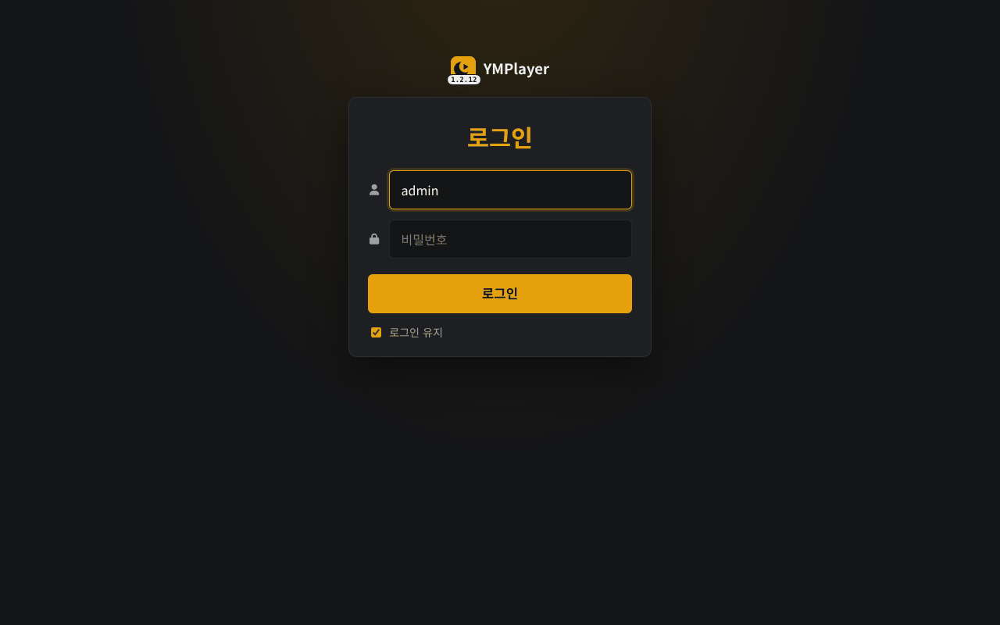
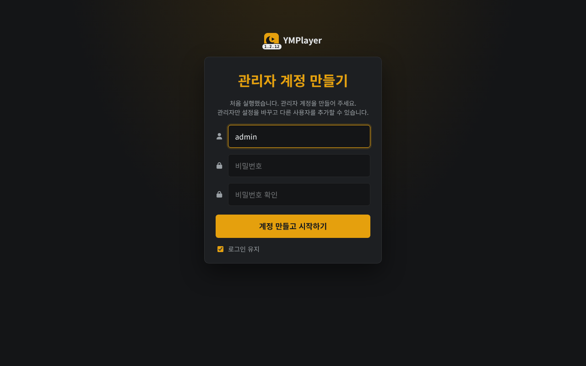

# YMPlayer 설치 가이드 ② 도커 (Docker Compose)

> 이 문서만 따라 하면 설치가 끝나도록 썼습니다. 리눅스 서버 + Docker Engine + Docker Compose(v2) 기준입니다.
> 가상환경으로 설치하려면 → [install-venv.md](install-venv.md) · 설치한 뒤 화면 설정 → [setup-guide.md](setup-guide.md)

도커는 "서버에 파이썬을 따로 깔지 않아도 된다"는 장점이 있지만, **업데이트할 때마다 이미지를 다시 만들어야 하고**
자동 올리기에서 Plex·rclone 파일을 읽으려면 **경로를 맞춰 마운트**해야 합니다. 특별한 이유가 없으면 가상환경 설치를 권합니다.

---

## 0. 무엇이 설치되나

| 항목 | 위치 (이 문서 기준) |
|---|---|
| 프로그램(저장소) | `/opt/ym_player` |
| 설정·사용자·텔레그램 세션·색인·캐시 | `/opt/ym_player/data` → 컨테이너 안 `/data` |
| 컨테이너 이름 | `ym_player` |
| 접속 주소 | `http://서버IP:8899` |

이미지에 들어 있는 것: Python 3.12, ffmpeg(서버 변환·인코딩), 한글 글꼴(자막 입히기), rclone.

---

## 1. 도커 설치 (이미 있으면 건너뛰기)

```bash
docker --version && docker compose version     # 둘 다 버전이 나오면 설치돼 있음
```

없으면 (Ubuntu/Debian):

```bash
curl -fsSL https://get.docker.com | sudo sh
sudo usermod -aG docker $USER     # sudo 없이 docker를 쓰려면 - 한 번 로그아웃했다 다시 로그인
```

---

## 2. 내려받기

```bash
sudo git clone https://github.com/yume-script/ym_player.git /opt/ym_player
sudo chown -R $USER:$USER /opt/ym_player
cd /opt/ym_player
cp docker-compose.example.yml docker-compose.yml
mkdir -p data
```

---

## 3. `docker-compose.yml` 고치기

```bash
nano docker-compose.yml
```

기본 내용(필요한 곳만 고치면 됩니다):

```yaml
services:
  ym_player:
    build: .
    container_name: ym_player
    restart: unless-stopped
    environment:
      TZ: Asia/Seoul
      MP_USER: admin            # 첫 관리자 아이디 (사용자가 하나도 없을 때 한 번만 만듦)
      MP_PASSWORD: change-me    # ← 반드시 바꾸기
    volumes:
      - ./data:/data            # 설정·사용자·세션·색인·캐시 (백업 대상)
    ports:
      - "8899:8899"             # 왼쪽(호스트 포트)을 바꾸면 그 포트로 접속
```

### 자동 올리기를 쓸 때만 추가하는 것

| 하려는 것 | `volumes:`에 추가 | 설명 |
|---|---|---|
| Plex 원본 파일을 바로 읽기 | `- /mnt/media:/mnt/media:ro,rslave` | **Plex가 보는 경로와 똑같은 경로**로. 안 맞으면 Plex에서 내려받아 올림(느리고 공간 필요) |
| rclone mount 폴더를 감시 | `- /mnt/gdrive:/mnt/gdrive:ro,rslave` | 호스트에서 rclone mount한 폴더. `rslave`는 마운트가 컨테이너보다 늦게 떠도 보이게 |
| rclone 원격(`gdrive:영화`) 직접 | `- /root/.config/rclone:/config/rclone:ro` + `environment:`에 `MP_RCLONE_CONFIG: /config/rclone/rclone.conf` | rclone.conf가 든 **폴더째** |
| Intel/AMD 그래픽 인코딩 | `devices:` 아래 `- /dev/dri:/dev/dri` | 호스트에 `/dev/dri`가 있을 때. 없으면 CPU로 인코딩 |

> NVIDIA 그래픽 인코딩은 호스트에 NVIDIA Container Toolkit이 있어야 하고 이미지도 CUDA용 ffmpeg가 필요해서 이 이미지로는 안 됩니다
> (CPU·Intel로 인코딩). NVIDIA를 쓰려면 가상환경 설치를 권합니다.

---

## 4. 빌드하고 실행

```bash
cd /opt/ym_player
docker compose up -d --build
docker compose logs -f --tail 50          # YMPlayer 1.x.x: http://0.0.0.0:8899 가 나오면 성공 (Ctrl+C로 나가기)
```

처음 빌드는 몇 분 걸립니다(ffmpeg·글꼴 내려받기).

브라우저: `http://서버IP:8899` → `MP_USER`/`MP_PASSWORD`로 로그인.



`MP_USER`/`MP_PASSWORD`를 비워 두었다면 처음 접속한 화면에서 관리자 계정을 만듭니다(띄우자마자 직접 만드세요).



로그인한 뒤에는 [setup-guide.md](setup-guide.md)를 따라 소스를 넣으세요.

---

## 5. 매일 쓰는 명령

| 하려는 것 | 명령 (`/opt/ym_player`에서) |
|---|---|
| 상태 보기 | `docker compose ps` |
| 로그 보기 | `docker compose logs -f --tail 100` (화면의 설정 > 로그에서도) |
| 다시 시작 | `docker compose restart` |
| 멈추기 / 다시 켜기 | `docker compose stop` / `docker compose start` |
| 지우기(데이터는 남음) | `docker compose down` |
| 컨테이너 안에 들어가기 | `docker exec -it ym_player bash` |

---

## 6. 업데이트

화면 왼쪽 위 아이콘 옆에 **[GitHub]**가 뜨면 새 버전이 있다는 뜻입니다. 도커는 **이미지를 다시 만들어야** 반영됩니다:

```bash
cd /opt/ym_player
git pull
docker compose up -d --build
```

`data/`는 볼륨이라 설정·사용자·텔레그램 로그인이 그대로 이어집니다. (화면의 업데이트 안내에 나오는 `systemctl restart`는 가상환경 설치용입니다.)

옛 이미지 정리: `docker image prune -f`

---

## 7. 백업과 옮기기

```bash
cd /opt/ym_player
docker compose stop
tar czf ~/ym_player_data.tgz data
docker compose start
```

새 서버에서는 2~3단계를 한 뒤 `data/`를 풀어 놓고 `docker compose up -d --build`. 텔레그램 세션까지 그대로 옮겨집니다.
화면의 설정 > 백업(JSON)도 됩니다 - 이때는 텔레그램만 다시 로그인합니다.

---

## 8. 밖(인터넷)에서 접속하려면

https 리버스 프록시 뒤에 두세요 (휴대폰 앱 설치·Claude 앱 연결은 https에서만). 같은 서버의 Caddy라면:

```
ymp.내도메인.com {
    reverse_proxy 127.0.0.1:8899
}
```

프록시만 접속하게 하려면 `ports:`를 `"127.0.0.1:8899:8899"`로 바꾸세요.

---

## 9. 자주 막히는 곳

| 증상 | 해결 |
|---|---|
| `permission denied ... docker.sock` | `sudo`를 붙이거나 `sudo usermod -aG docker $USER` 후 다시 로그인 |
| 접속이 안 됨 | `docker compose ps`로 `Up` 확인, `docker compose logs`에서 오류 확인, 방화벽 `sudo ufw allow 8899/tcp` |
| 자동 올리기 폴더 규칙에서 폴더가 비어 보임 | 호스트의 rclone mount가 컨테이너보다 늦게 떴습니다. 볼륨에 `rslave`를 붙였는지 확인하고 `docker compose restart` |
| 자동 올리기가 Plex 파일을 매번 내려받음 | Plex가 보는 경로(예: `/data/movies`)와 컨테이너 안 경로가 다릅니다. 같은 경로로 마운트하세요 |
| 시간이 9시간 어긋남 | `environment:`의 `TZ: Asia/Seoul`을 지우지 마세요 |
| 업데이트했는데 그대로 | `git pull` 후 `--build`를 빼먹었습니다. `docker compose up -d --build` |
| 데이터가 사라짐 | `./data:/data` 볼륨을 지웠거나 다른 폴더에서 compose를 실행했습니다. `/opt/ym_player`에서 실행하세요 |

---

## 환경변수 (`environment:`)

| 변수 | 기본값(이미지) | 설명 |
|---|---|---|
| `MP_USER` / `MP_PASSWORD` | (없음) | 사용자가 없을 때 만들 첫 관리자 |
| `MP_PORT` | `8899` | 컨테이너 안 포트 (보통 그대로 두고 `ports:` 왼쪽만 바꿈) |
| `MP_DATA_DIR` | `/data` | 바꾸지 마세요 (볼륨 위치) |
| `MP_MAX_TRANSCODES` | `3` | 동시에 돌릴 서버 변환 수 |
| `MP_RCLONE_CONFIG` | (rclone 기본 위치) | 자동 올리기의 rclone 원격용 설정 파일 |
| `MP_UPDATE_CHECK` | `1` | `0`이면 GitHub 새 버전 확인 안 함 |
| `MP_ACTIVITY_TOKEN` | (없음) | 재생 현황 API용 토큰 |
| `TZ` | `Asia/Seoul` | 시간대 |
