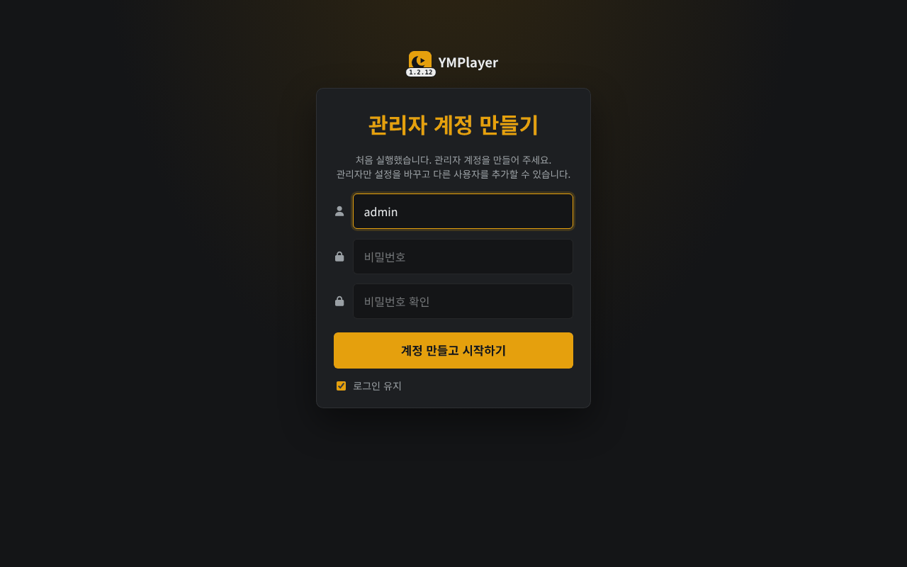
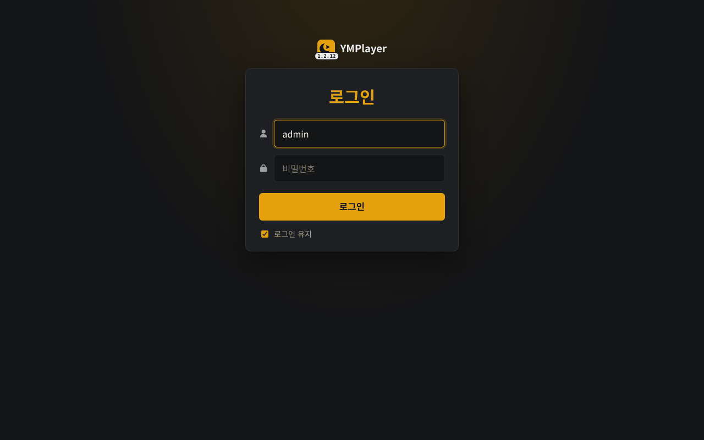
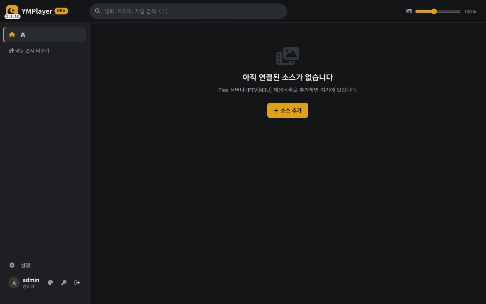

# YMPlayer 설치 가이드 ① 가상환경(venv) + systemd

> 이 문서만 따라 하면 설치가 끝나도록 썼습니다. 리눅스(Ubuntu 22.04/24.04, Debian 12) 서버를 기준으로 합니다.
> 도커로 설치하려면 → [install-docker.md](install-docker.md) · 설치한 뒤 화면 설정 → [setup-guide.md](setup-guide.md)

**권장 방식입니다.** 도커보다 막히는 곳(경로 맞추기, 파일 권한, 업데이트할 때마다 이미지 다시 만들기)이 적습니다.

---

## 0. 무엇이 설치되나

| 항목 | 위치 (이 문서 기준) |
|---|---|
| 프로그램 | `/opt/ym_player` (git 저장소) |
| 파이썬 가상환경 | `/opt/ym_player/.venv` |
| 설정·사용자·텔레그램 세션·색인·캐시 | `/opt/ym_player/ym_player/data` (바꾸려면 `MP_DATA_DIR`) |
| 서비스 설정(포트·첫 관리자) | `/etc/ym_player.env` |
| 서비스 | `ym_player` (systemd) |
| 접속 주소 | `http://서버IP:8899` |

다른 폴더에 두고 싶으면 아래 명령의 `/opt/ym_player`를 모두 그 경로로 바꾸세요.

---

## 1. 필요한 프로그램 설치

```bash
sudo apt update
sudo apt install -y git python3 python3-venv python3-pip ffmpeg fonts-nanum
```

| 패키지 | 왜 필요한가 | 없으면 |
|---|---|---|
| `git` | 내려받기·업데이트 | 설치 불가 |
| `python3` (3.10 이상), `python3-venv` | 프로그램 실행, 가상환경 | 설치 불가 |
| `ffmpeg` | 텔레그램의 mkv·HEVC·AC-3 영상 서버 변환, 자동 올리기 인코딩·나눠 올리기 | 그 기능만 안 됨 |
| `fonts-nanum` | 자동 올리기에서 한글 자막을 화면에 입힐 때 글꼴 | 자막 글자가 네모로 나옴 |

파이썬 버전 확인: `python3 --version` → `Python 3.10` 이상이면 됩니다.

(선택) 자동 올리기에서 rclone 원격(`gdrive:영화` 같은 이름)을 쓰려면 rclone도: `sudo -v ; curl https://rclone.org/install.sh | sudo bash`

---

## 2. 내려받기

```bash
sudo git clone https://github.com/yume-script/ym_player.git /opt/ym_player
cd /opt/ym_player
```

> 일반 사용자 계정으로 돌리고 싶으면 `sudo chown -R $USER:$USER /opt/ym_player` 후 아래 명령에서 `sudo`를 빼세요.

---

## 3. 가상환경 만들고 패키지 설치

```bash
cd /opt/ym_player
sudo python3 -m venv .venv
sudo .venv/bin/pip install --upgrade pip
sudo .venv/bin/pip install -r requirements.txt
```

- **꼭 `.venv/bin/pip`로** 설치하세요. 그냥 `pip install`은 Ubuntu/Debian에서 막히거나(`externally-managed-environment`) 다른 파이썬에 깔립니다.
- 설치되는 것: `aiohttp`(웹 서버), `telethon`(텔레그램), `cryptg`(텔레그램 암호화를 빠르게), `PyYAML`.
- `cryptg` 설치에서 오류가 나면(드문 CPU) 나머지만 깔고 넘어가도 됩니다 - 텔레그램이 조금 느려질 뿐입니다:
  `sudo .venv/bin/pip install aiohttp telethon PyYAML`

---

## 4. 한 번 직접 실행해 보기

```bash
cd /opt/ym_player
sudo MP_HOST=0.0.0.0 .venv/bin/python -m ym_player
```

`YMPlayer 1.x.x: http://0.0.0.0:8899` 줄이 나오면 성공입니다. 브라우저로 `http://서버IP:8899`에 들어가면
**관리자 계정 만들기** 화면이 나옵니다. 확인했으면 `Ctrl+C`로 끄고 다음 단계로 (서비스로 등록하면 그쪽에서 만들어도 됩니다).



> `MP_HOST=0.0.0.0`은 다른 PC·TV·폰에서 접속하게 여는 것입니다. 빼면 이 서버 안(`127.0.0.1`)에서만 열립니다.

---

## 5. 서비스로 등록 (부팅할 때 자동 실행)

### 5-1. 설정 파일

```bash
sudo cp /opt/ym_player/deploy/ym_player.env.example /etc/ym_player.env
sudo chmod 600 /etc/ym_player.env
sudo nano /etc/ym_player.env
```

꼭 바꿀 것:

```ini
MP_HOST=0.0.0.0          # 다른 기기에서 접속 (이 서버 안에서만 쓰면 127.0.0.1)
MP_PORT=8899
MP_USER=yume             # 첫 관리자 아이디 (사용자가 하나도 없을 때 한 번만 만듦)
MP_PASSWORD=change-me    # ← 반드시 바꾸기. 나중에 화면에서 바꿔도 됨
```

이 파일에 넣을 수 있는 값 전체는 [아래 표](#환경변수-전체)를 보세요.

### 5-2. 서비스 파일

저장소의 `deploy/ym_player.service`는 `/mnt/ym_player`에 설치했다고 가정합니다. `/opt/ym_player`에 설치했으니 경로를 바꿔 복사합니다:

```bash
sed 's#/mnt/ym_player#/opt/ym_player#g' /opt/ym_player/deploy/ym_player.service | sudo tee /etc/systemd/system/ym_player.service > /dev/null
sudo systemctl daemon-reload
sudo systemctl enable --now ym_player
```

### 5-3. 확인

```bash
systemctl status ym_player          # active (running) 이면 성공
journalctl -u ym_player -f          # 실시간 로그 (Ctrl+C로 나가기)
```

브라우저: `http://서버IP:8899` → 5-1에서 넣은 아이디/비밀번호로 로그인.



로그인하면 아직 소스가 없어서 빈 홈이 나옵니다. 이제 [setup-guide.md](setup-guide.md)를 따라 소스(Plex·텔레그램·IPTV·라디오…)를 넣으세요.


접속이 안 되면 방화벽을 확인하세요: `sudo ufw allow 8899/tcp`

---

## 6. 업데이트

화면 왼쪽 위 아이콘 옆에 **[GitHub]**가 뜨면 새 버전이 있다는 뜻입니다 (설정 > 상태 > 업데이트에서도 확인).

```bash
cd /opt/ym_player
sudo git pull
sudo .venv/bin/pip install -r requirements.txt     # 새 패키지가 생겼을 때만 실제로 설치됨 (매번 해도 안전)
sudo systemctl restart ym_player
```

설정·사용자·텔레그램 로그인은 `ym_player/data`에 있어 업데이트해도 그대로입니다.

---

## 7. 백업과 옮기기

- **화면에서**: 설정 > 백업 > [백업 받기] - 설정·사용자·즐겨찾기·아이콘이 JSON 하나로 (Plex 토큰·API Hash가 들어 있으니 잘 보관).
  텔레그램 로그인 세션과 색인은 들어가지 않으므로 새 서버에서는 텔레그램만 다시 로그인합니다.
- **폴더째**: 서비스를 멈추고 `ym_player/data` 폴더를 통째로 복사하면 텔레그램 세션까지 그대로 옮겨집니다.
  ```bash
  sudo systemctl stop ym_player
  sudo tar czf ~/ym_player_data.tgz -C /opt/ym_player/ym_player data
  sudo systemctl start ym_player
  ```

---

## 8. 밖(인터넷)에서 접속하려면

집 밖에서 쓰려면 공유기 포트포워딩보다 **https 리버스 프록시**(Nginx Proxy Manager, Caddy 등) 뒤에 두기를 권합니다.
휴대폰 "홈 화면에 추가"(앱처럼 설치)와 Claude 앱 연결(MCP)은 https 주소에서만 됩니다.

Caddy 예 (`/etc/caddy/Caddyfile`):

```
ymp.내도메인.com {
    reverse_proxy 127.0.0.1:8899
}
```

이때 YMPlayer는 `MP_HOST=127.0.0.1`로 두어도 됩니다 (프록시만 접속).

---

## 9. 자주 막히는 곳

| 증상 | 해결 |
|---|---|
| `error: externally-managed-environment` | `pip` 대신 `.venv/bin/pip`를 쓰세요 (3단계) |
| `python3 -m venv` 실패 (`ensurepip is not available`) | `sudo apt install python3-venv` (버전이 붙은 `python3.12-venv`일 수도) |
| 다른 기기에서 접속 안 됨 | `/etc/ym_player.env`의 `MP_HOST=0.0.0.0` 확인 → `sudo systemctl restart ym_player`, 방화벽 `sudo ufw allow 8899/tcp` |
| `status`가 `failed` | `journalctl -u ym_player -n 50`으로 마지막 오류 확인. 경로(5-2)가 맞는지, `.venv`가 있는지 |
| 포트가 이미 쓰임 (`address already in use`) | `MP_PORT`를 다른 값(예: 8898)으로 |
| 텔레그램 영상 중 안 나오는 것이 있음 | `ffmpeg` 설치 확인: `ffmpeg -version` |
| 로그인 화면 대신 "관리자 계정 만들기"가 다시 나옴 | 데이터 폴더가 바뀌었습니다 (`MP_DATA_DIR`). 원래 폴더를 가리키게 하세요 |
| 비밀번호를 잊음 | 다른 관리자로 설정 > 사용자에서 재설정. 관리자가 하나뿐이면 서비스를 멈추고 `data/users.json`을 다른 이름으로 옮긴 뒤 시작 → `MP_USER`/`MP_PASSWORD`로 새 관리자 (다른 사용자 목록도 사라지니 주의) |

화면의 **설정 > 로그**에서 서버 로그를 바로 볼 수 있습니다 (파일: `data/logs/ymplayer.log`).

---

## 환경변수 전체

`/etc/ym_player.env`(서비스) 또는 실행할 때 앞에 붙여 줍니다. 대부분은 비워 두면 됩니다.

| 변수 | 기본값 | 설명 |
|---|---|---|
| `MP_HOST` | `127.0.0.1` | 열 주소. 다른 기기에서 접속하려면 `0.0.0.0` |
| `MP_PORT` | `8899` | 포트 |
| `MP_USER` / `MP_PASSWORD` | (없음) | 사용자가 없을 때 만들 첫 관리자. 이미 사용자가 있으면 무시 |
| `MP_DATA_DIR` | `<저장소>/ym_player/data` | 설정·사용자·세션·색인·캐시 폴더 |
| `MP_FFMPEG` / `MP_FFPROBE` | PATH에서 찾음 | ffmpeg 경로를 따로 줄 때 |
| `MP_MAX_TRANSCODES` | `3` | 동시에 돌릴 서버 변환 수 (CPU를 많이 씀) |
| `MP_RCLONE` / `MP_RCLONE_CONFIG` | PATH / rclone 기본 위치 | 자동 올리기 폴더 규칙의 rclone 실행 파일·설정 파일 |
| `MP_UPDATE_CHECK` | `1` | `0`이면 GitHub 새 버전 확인 안 함 |
| `MP_ACTIVITY_TOKEN` | (없음) | 재생 현황 API(`/api/activity`)를 로그인 없이 볼 토큰 (부하 조절 봇용) |
