# YMPlayer 설정 가이드

> 설치를 마치고 처음 로그인한 다음부터 보는 문서입니다. 설치는 [install-venv.md](install-venv.md)(권장) 또는 [install-docker.md](install-docker.md).
> 모든 설정은 **관리자**로 로그인해서 왼쪽 아래 ⚙️ **설정**에서 합니다. 일반 사용자에게는 설정 메뉴가 보이지 않습니다.

## 차례
1. [처음 로그인](#1-처음-로그인)
2. [설정 화면 둘러보기](#2-설정-화면-둘러보기)
3. [소스 넣기](#3-소스-넣기) — Plex · 텔레그램 · IPTV · 라디오 · 공중파 라디오 · 팟캐스트 · CCTV · 브런치/레시피 · BookOasis
4. [사용자와 볼 수 있는 범위](#4-사용자와-볼-수-있는-범위)
5. [상태 · 로그 (문제가 생겼을 때)](#5-상태--로그-문제가-생겼을-때)
6. [캐시 · 화면 · 백업](#6-캐시--화면--백업)
7. [자동 올리기 (Plex·rclone → 텔레그램)](#7-자동-올리기-plexrclone--텔레그램)
8. [디스코드 · MCP(AI 앱 연결)](#8-디스코드--mcpai-앱-연결)
9. [휴대폰에서 쓰기](#9-휴대폰에서-쓰기)

---

## 1. 처음 로그인

사용자가 하나도 없으면 첫 화면이 **관리자 계정 만들기**입니다. 아이디와 비밀번호(두 번)를 넣고 [계정 만들고 시작하기].
`MP_USER`/`MP_PASSWORD`를 넣고 설치했다면 이 화면 없이 바로 로그인 화면이 나옵니다.

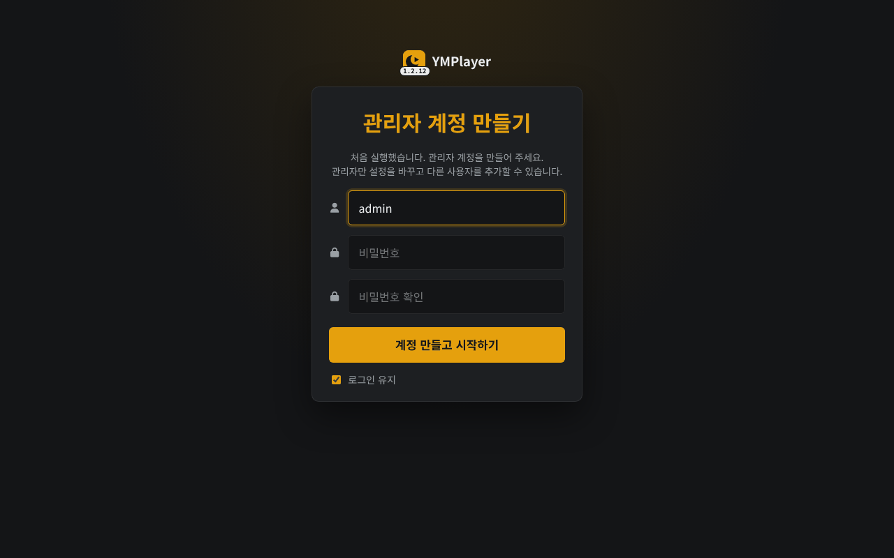

다음부터는 로그인 화면입니다. **로그인 유지**를 켜면 30일 동안 다시 묻지 않습니다.

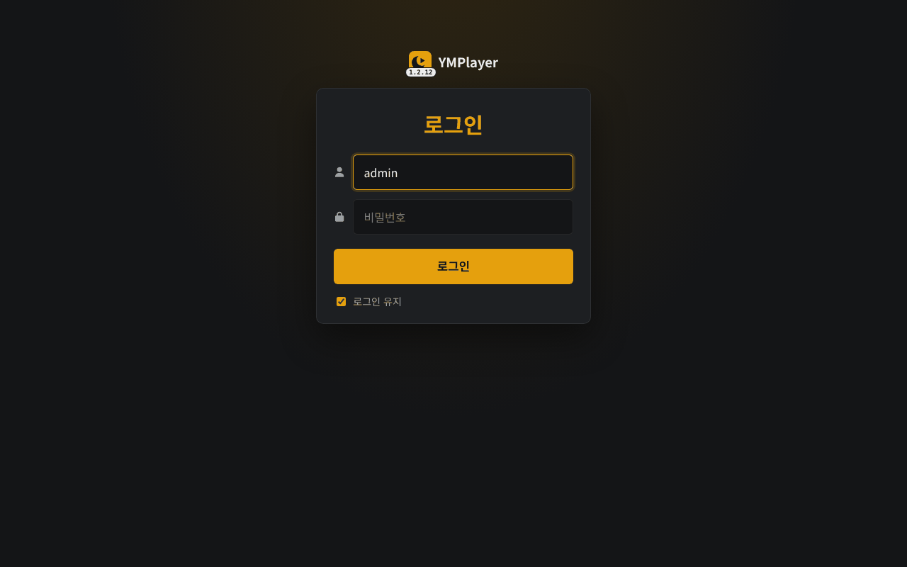

처음에는 소스가 없어서 홈이 비어 있습니다. [+ 소스 추가]나 왼쪽 아래 ⚙️ 설정으로 갑니다.

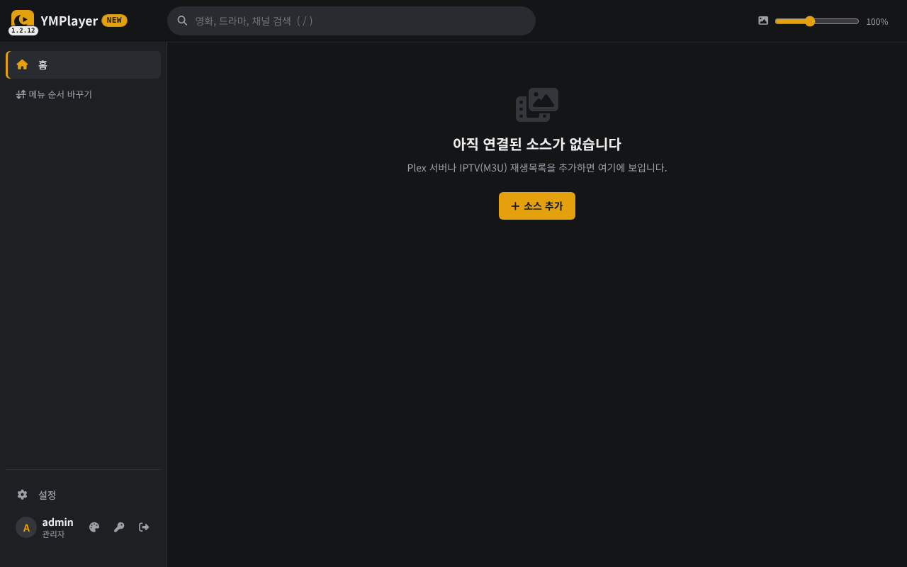

---

## 2. 설정 화면 둘러보기

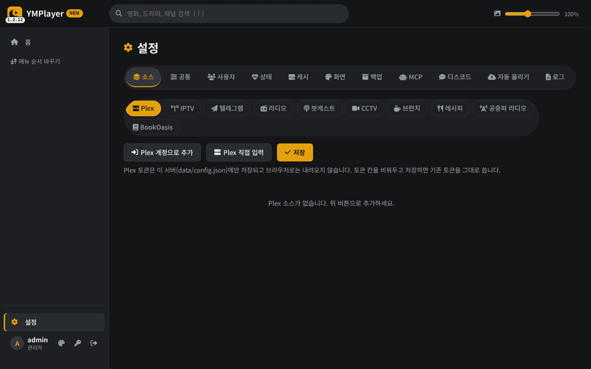

| 탭 | 하는 일 |
|---|---|
| **소스** | 볼 것(Plex·텔레그램·IPTV·라디오…)을 넣고 빼기. 아래 하위 탭으로 종류를 고름 |
| **공통** | 모든 사용자에게 적용: 웹툰 목록에서 BL·GL 숨기기, Plex에서 틀 때 텔레그램에 같은 영상(자동 올리기로 올린 것)이 있으면 그것을 먼저 |
| **사용자** | 사용자 추가·삭제, 관리자/사용자, 비밀번호, 볼 수 있는 범위 |
| **상태** | 소스마다 실제로 연결해 보는 점검, 서버 정보, 느린 요청, GitHub 새 버전 |
| **캐시** | 동영상 캐시 켜기/끄기, 폴더, 용량 |
| **화면** | 왼쪽 위 이름·아이콘, 버전 배지, 모든 사용자의 기본 테마 |
| **백업** | 설정 전체를 JSON 파일로 받기 / 복원 |
| **MCP** | Claude 같은 AI 앱 연결 토큰 |
| **디스코드** | 디스코드 채널의 새 글을 화면 아래로 흘리기 |
| **자동 올리기** | Plex·rclone 드라이브의 새 동영상을 텔레그램 채널로 |
| **로그** | 서버 로그 보기·받기 |
| **Thanks to** | 참고한 저장소, 변경 이력 |

**소스 넣는 순서는 모두 같습니다**: 하위 탭(Plex·IPTV·텔레그램…) 고르기 → **[○○ 추가]** → 칸 채우기 → **[저장]**.
소스 카드 오른쪽의 **사용** 체크로 잠시 끄고, ↑↓로 사이드바 순서를 바꾸고, 🗑로 지웁니다. 저장하기 전에는 아무것도 바뀌지 않습니다.

---

## 3. 소스 넣기

### 3-1. Plex

두 가지 방법이 있습니다.

**① Plex 계정으로 추가 (쉬움)** — [Plex 계정으로 추가]를 누르면 plex.tv 로그인 창이 뜹니다. 허용하면 계정에 연결된 서버와
접속 주소(로컬/원격/릴레이) 목록이 나옵니다. **같은 집 안이면 로컬 주소**(`192.168.x.x`)를 고르고 [저장].

**② Plex 직접 입력** — [Plex 직접 입력]을 누르고:

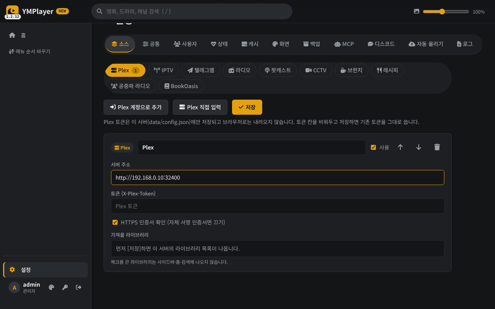

| 칸 | 넣을 것 |
|---|---|
| 서버 주소 | `http://192.168.0.10:32400` (YMPlayer 서버에서 닿는 Plex 주소) |
| 토큰 (X-Plex-Token) | Plex 웹에서 아무 영화 → `…` → **미디어 정보** → **XML 보기** → 주소창 끝의 `X-Plex-Token=` 뒤 값 |
| HTTPS 인증서 확인 | 보통 켜 둠. 자체 서명 인증서를 쓰는 https 주소면 끔 (`http://`면 상관없음) |

[저장]하면 **가져올 라이브러리** 체크 목록이 나옵니다. 끈 라이브러리는 사이드바·홈·검색에서 빠집니다.

> 토큰은 서버(`data/config.json`)에만 저장되고 브라우저로 내려가지 않습니다. 토큰 칸을 비워 두고 저장하면 기존 토큰을 그대로 씁니다.

### 3-2. 텔레그램 채널

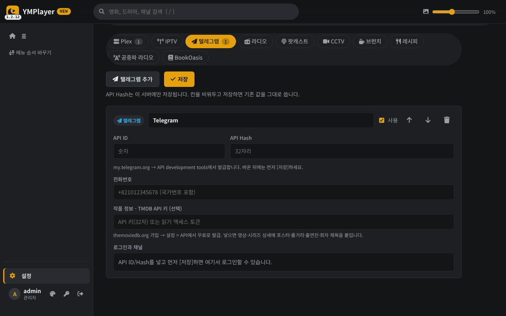

1. [my.telegram.org](https://my.telegram.org)에 전화번호로 로그인 → **API development tools** → 앱 이름 아무거나 넣고 만들기
   → **App api_id**(숫자)와 **App api_hash**(32자리)를 복사합니다.
2. YMPlayer: 소스 > 텔레그램 > **[텔레그램 추가]** → **API ID**, **API Hash**, **전화번호**(`+8210…` 국가번호 포함) → **[저장]**.
3. 같은 카드의 **로그인과 채널**에 [인증 코드 받기]가 생깁니다 → 텔레그램 앱으로 온 숫자를 넣고 [로그인]
   (2단계 인증을 쓰면 비밀번호도).
4. 로그인되면 들어가 있는 **채널·그룹 목록**이 나옵니다. 볼 채널을 체크하고(채널마다 영상/사진/웹툰/책 종류를 고를 수 있음) 다시 **[저장]**.
   체크한 채널이 사이드바에 라이브러리처럼 붙습니다.
5. (선택) **TMDB API 키**: [themoviedb.org](https://www.themoviedb.org) 가입 → 설정 > API에서 무료 발급. 넣으면 영상에 포스터·줄거리·출연진이 붙습니다.

> - 처음 여는 채널은 최근 영상 400개를 훑을 때까지 몇 초 기다립니다. 그 뒤로는 바로 나오고 오래된 쪽은 뒤에서 채웁니다.
> - mkv·HEVC 영상까지 보려면 서버에 ffmpeg가 있어야 합니다(설치 가이드 1단계).
> - 로그인 세션은 `data/telegram_<id>.session`에 있습니다 - 계정 열쇠이니 남에게 주지 마세요.

### 3-3. IPTV (M3U + 편성표)

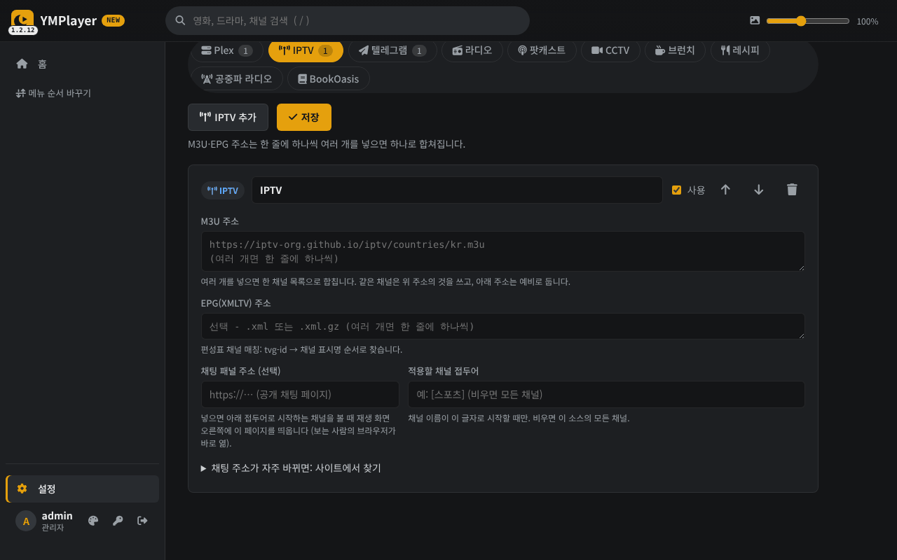

| 칸 | 넣을 것 |
|---|---|
| M3U 주소 | `http://…/playlist.m3u` - 여러 개면 **한 줄에 하나** (같은 채널은 합쳐지고 뒤 주소는 예비 주소가 됨) |
| EPG(XMLTV) 주소 | `http://…/epg.xml` 또는 `.xml.gz` (선택, 여러 줄 가능) |
| 채팅 패널 (선택) | 스포츠 중계 등 옆에 띄울 공개 채팅 페이지 주소 + 적용할 채널 이름 접두어 |

저장하면 사이드바에 **라이브 TV**, 홈에 채널 줄이 생깁니다. 채널을 별로 즐겨찾기하면 사람마다 서버에 저장됩니다.

### 3-4. 인터넷 라디오

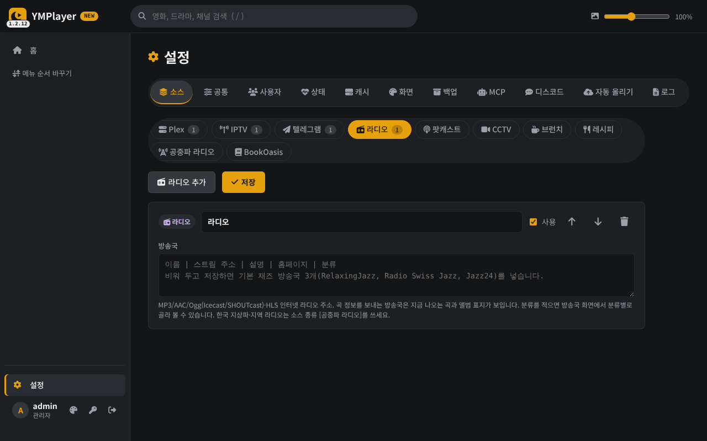

방송국 칸을 **비워 두고 저장하면** 공개 재즈 방송국 3개가 들어갑니다. 더 넣으려면 한 줄에 하나:

```
방송국 이름 | 스트림 주소 | 설명 | 홈페이지
Jazz24 | https://live.wostreaming.net/direct/ppm-jazz24aac256-ibc1 | 미국 재즈 | https://www.jazz24.org
```

MP3·AAC·Ogg(Icecast·SHOUTcast)와 HLS(`.m3u8`) 모두 됩니다. 곡 정보(ICY)를 보내는 방송국은 지금 나오는 곡과 앨범 표지가 보입니다.

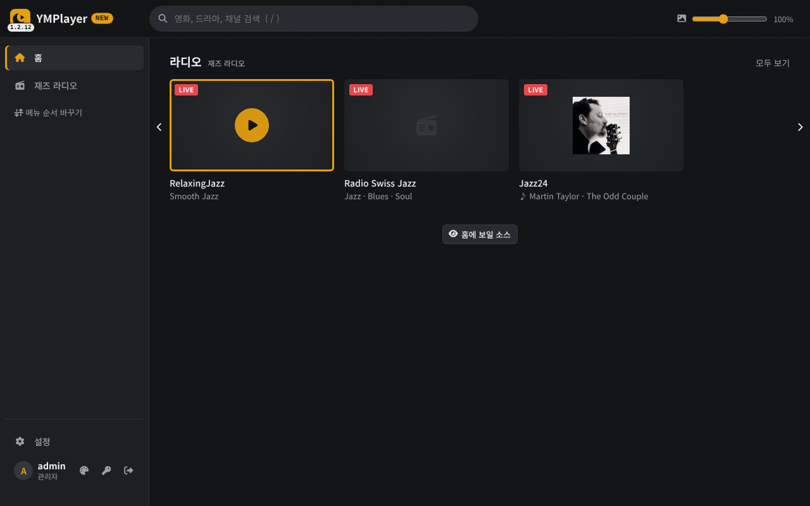

### 3-5. 공중파 라디오 (KBS·MBC·SBS·지역국)

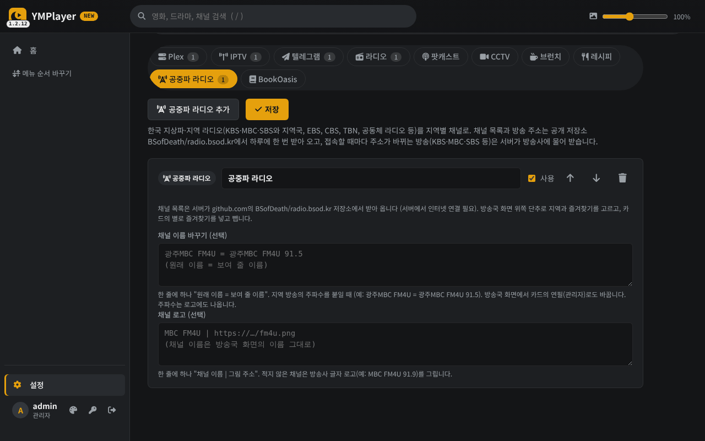

[공중파 라디오 추가] → [저장]이면 끝입니다. 채널 목록과 방송 주소는 서버가 공개 저장소에서 하루에 한 번 받아 옵니다.

- **채널 로고**: 한 줄에 하나 `채널 이름 | 그림 주소`. 없으면 글자 로고를 그립니다.
- **채널 이름 바꾸기**: 지역 방송 주파수를 붙이고 싶을 때 `원래 이름 | 새 이름`. 방송국 화면 위 **[편집]**을 켜고 카드의 연필로 바꿔도 됩니다.
- 서버가 `raw.githubusercontent.com`과 각 방송사에 닿아야 합니다(일부 방송사는 해외 서버 접속을 막음).

### 3-6. 팟캐스트

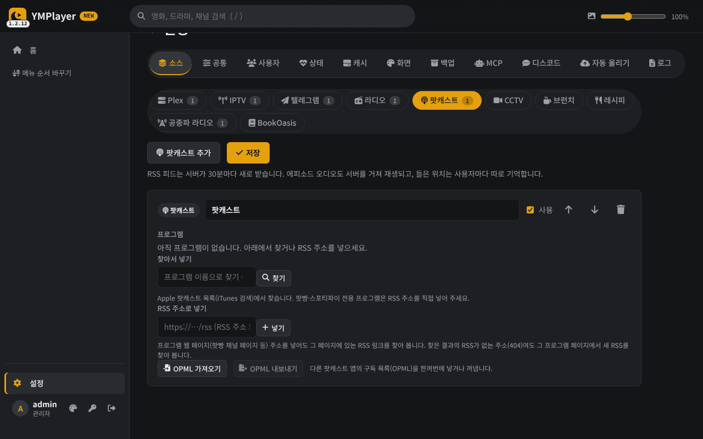

- **찾아서 넣기**: 프로그램 이름으로 찾기 → [넣기]
- **RSS 주소로 넣기**: 팟빵 등의 RSS 주소(또는 프로그램 웹 페이지 주소)
- **OPML 가져오기/내보내기**: 다른 팟캐스트 앱의 구독 목록 한꺼번에

넣은 뒤 [저장]. 들은 위치는 사용자마다 따로 기억합니다.

### 3-7. 도로 CCTV

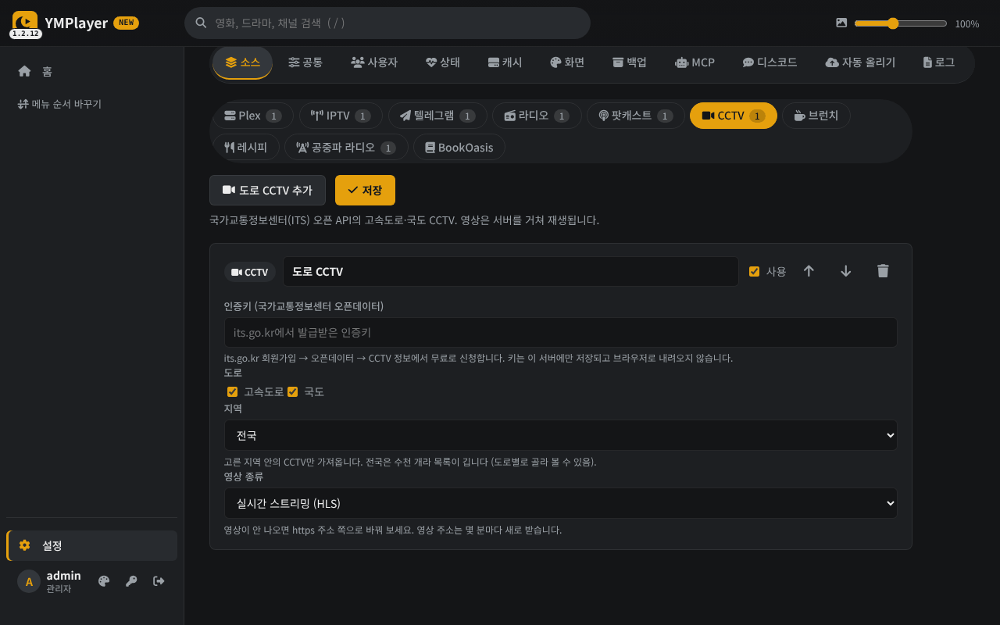

[국가교통정보센터](https://www.its.go.kr) 회원가입 → 오픈데이터 → **CCTV 정보** 신청 → 받은 **인증키**를 넣고, 도로(고속도로·국도)·지역을 고른 뒤 [저장].

### 3-8. 브런치 연재 · 만개의레시피

[브런치 연재 추가] / [만개의레시피 추가] → [저장]. 넣을 값은 없습니다(서버에서 인터넷 연결만 필요).

### 3-9. BookOasis (책·오디오북·영상)

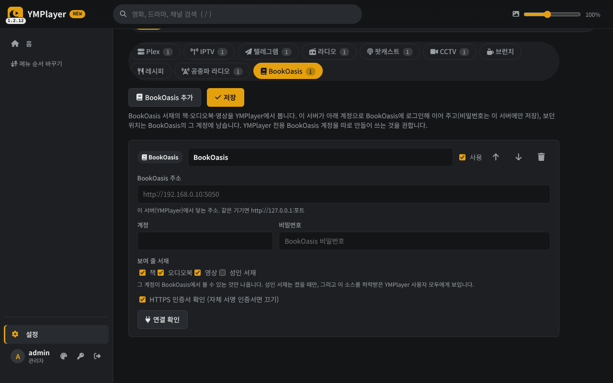

| 칸 | 넣을 것 |
|---|---|
| 주소 | YMPlayer 서버에서 닿는 BookOasis 주소, 예: `http://192.168.0.10:5930` |
| 계정 / 비밀번호 | BookOasis 계정 (**YMPlayer 전용 계정을 하나 만들어 쓰기를 권함** - 보던 위치가 그 계정에 남음) |
| 보여 줄 서재 | 책 / 오디오북 / 영상 / 성인(기본 꺼짐) |

---

## 4. 사용자와 볼 수 있는 범위

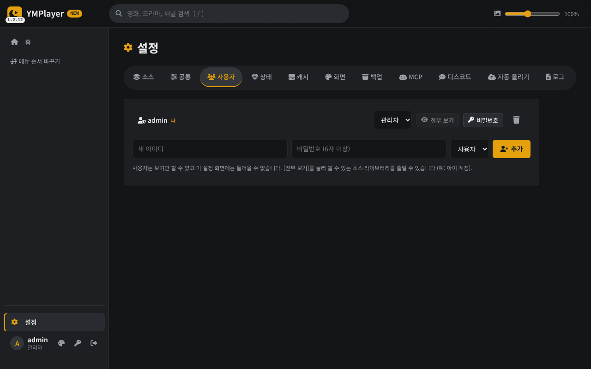

- 아래 칸에 새 아이디·비밀번호(6자 이상)·권한(사용자/관리자)을 넣고 **[추가]**.
- **사용자**는 보기만 합니다(설정 메뉴가 안 보이고, 주소로 들어가도 서버가 막음).
- **볼 수 있는 범위**: 사용자 줄의 [전부 보기]를 눌러 볼 소스·Plex 라이브러리·텔레그램 채널·팟캐스트를 고릅니다
  (예: 아이 계정은 "애니" 라이브러리와 채널 하나만). 고르지 않은 것은 홈·검색·이어보기에서도 빠집니다.
- 비밀번호는 각자 왼쪽 아래 🔑로 바꿉니다. 관리자는 여기서 다른 사람 비밀번호를 다시 정할 수 있습니다.

---

## 5. 상태 · 로그 (문제가 생겼을 때)

**상태**: 소스마다 실제로 연결해 보고 ✓/✗와 이유를 보여 줍니다. 무엇이 안 되면 먼저 여기를 보세요.
아래에 서버 정보(버전·가동 시간·ffmpeg 있음/없음·데이터 폴더), 느린 요청 TOP 10, GitHub 새 버전 확인이 있습니다.

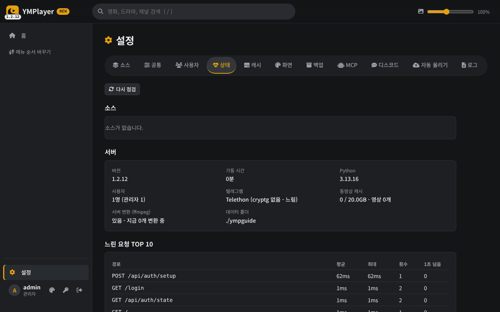

**로그**: 서버 로그를 수준(전체·경고 이상·오류만)과 찾을 말로 걸러 봅니다. 5초마다 새 줄이 위에 붙고 [파일 받기]로 내려받습니다.
문의할 때는 이 파일을 같이 주세요.

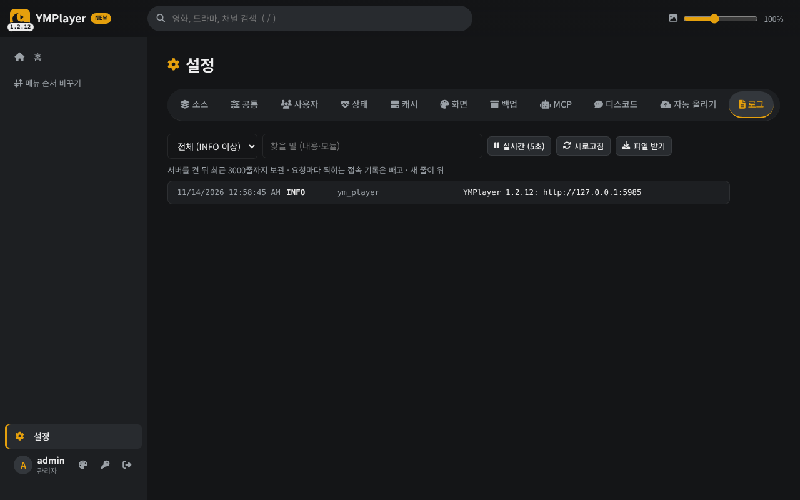

---

## 6. 캐시 · 화면 · 백업

**캐시**: 텔레그램·Plex 원본 재생 때 본 부분을 디스크에 남겨 다시 볼 때 빠르게 합니다. 기본 20GB(`data/cache/`).
디스크가 작으면 용량을 줄이거나 다른 디스크의 폴더로 바꾸세요.

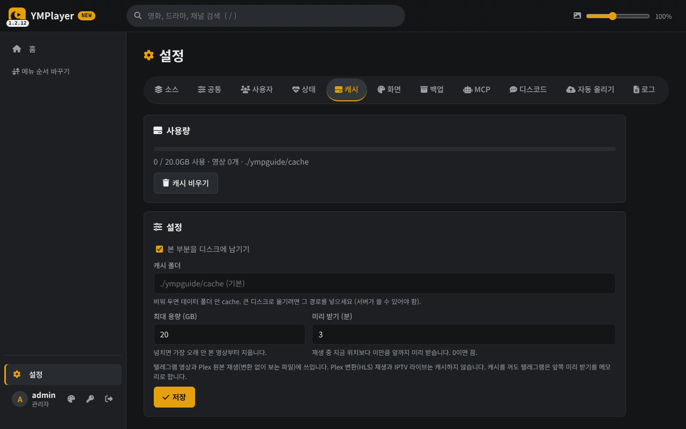

**화면**: 왼쪽 위 이름·아이콘(로그인 화면·브라우저 탭에도 쓰임), 버전 배지 켜기/끄기, 모든 사용자의 기본 테마.
사람마다는 왼쪽 아래 🎨에서 자기 테마를 고릅니다.

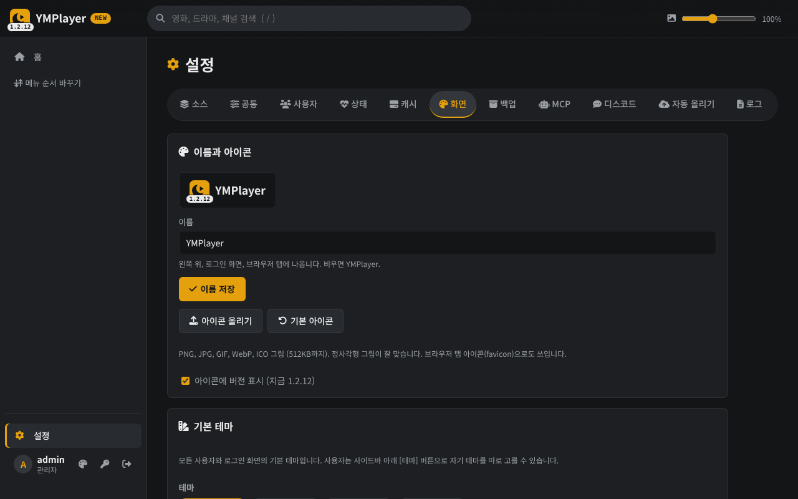

**백업**: [백업 받기]로 설정·사용자·즐겨찾기·아이콘을 JSON 하나로 받고, 그 파일로 복원합니다.
Plex 토큰·텔레그램 API Hash가 들어 있으니 안전하게 보관하세요. 텔레그램 로그인은 복원 뒤 다시 합니다.

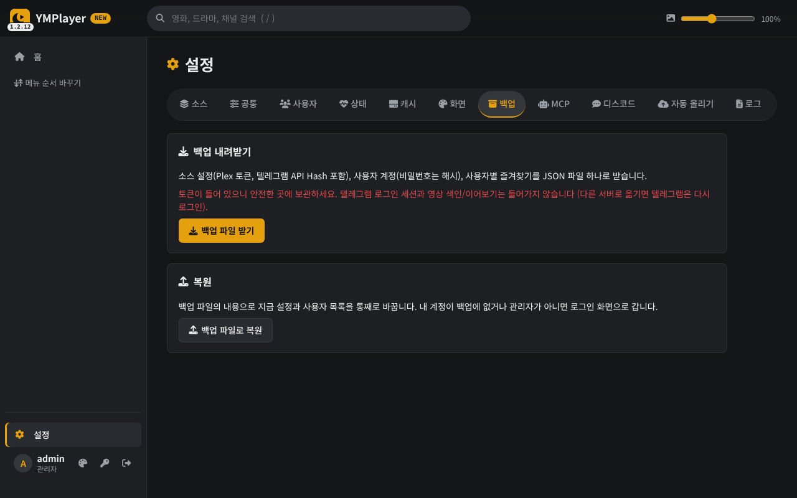

---

## 7. 자동 올리기 (Plex·rclone → 텔레그램)

Plex 라이브러리나 rclone 드라이브 폴더에 **새로 들어온 동영상을 텔레그램 채널에 자동으로** 올립니다.
텔레그램 앱에서 바로 재생되는 mp4(H.264/AAC)로 만들고, 큰 파일은 `이름_0000.mp4`, `이름_0001.mp4`…로 나눕니다.
(같은 기능이 [BookOasis Assistant](https://github.com/yume-script/bookoasis_assistant)에도 있습니다. 같은 채널에 둘 다 켜면 두 번 올라가니 한쪽에서만.)

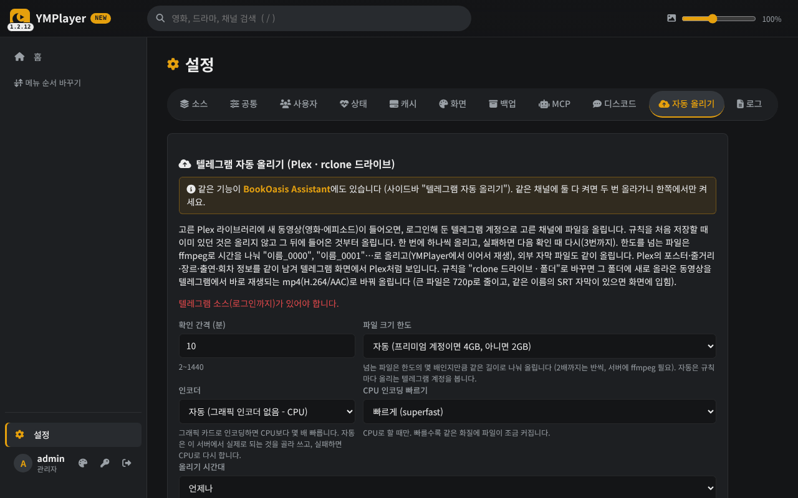

**미리 할 것**: 텔레그램 소스를 넣고 로그인(3-2), 서버에 ffmpeg, 올릴 채널에 글을 쓸 수 있는 계정(채널 관리자).

1. **[규칙 추가]** → 종류를 고릅니다.
   - **Plex 라이브러리**: 넣어 둔 Plex 소스의 영화·TV 라이브러리 하나.
   - **rclone 드라이브 · 폴더**: [고르기]로 rclone mount 폴더나 rclone 원격(`gdrive:영화`)을 고르거나 직접 적기. 하위 폴더까지 봅니다.
2. **올릴 텔레그램**: 텔레그램 소스와 채널.
3. **화질**: 기본 720p (그보다 높은 영상은 줄임). **원본 그대로**도 됩니다.
4. **자막**: "자막이 생길 때까지 기다렸다가 올리기"(기본 12시간), "자막을 화면에 입혀 인코딩"(텔레그램 앱에서도 자막이 보임).
5. **캡션**: `{name}`(제목), `{summary}`(줄거리) 등.
6. **[저장]**. 처음 저장할 때 이미 있던 것은 올리지 않고 **그 뒤에 들어온 것부터** 올립니다.
   바로 시험하려면 규칙의 **[가장 최근 것 하나 올려 보기]**.

위쪽 공통 설정: 확인 간격(기본 10분), 파일 크기 한도(자동 = 프리미엄 4GB / 일반 2GB), 인코더(그래픽 카드가 있으면 자동으로 씀),
**올리기 시간대**(예: 새벽 1~7시에만 - 사람들이 보는 시간에 서버를 쉬게).

아래 **상태**에서 올리는 중(진행률)·올릴 차례·자막 기다림(10분 지점 장면으로 하드섭인지 보고 [지금 올리기]/[빼기])·다시 시도 대기·최근 기록을 봅니다.
항목마다 [취소], 여러 개면 [전체 취소].

---

## 8. 디스코드 · MCP(AI 앱 연결)

**디스코드 새 글 흘리기**: 정한 디스코드 채널에 새 글이 올라오면 모든 사용자 화면 아래로 뉴스 자막처럼 흐릅니다.

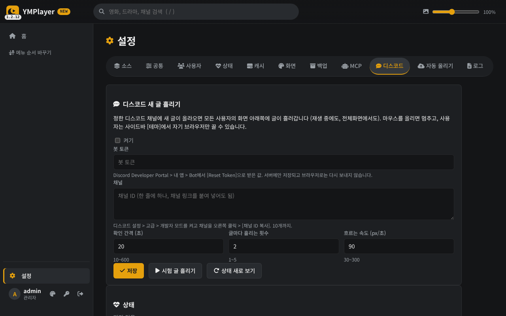

1. [Discord Developer Portal](https://discord.com/developers/applications) → New Application → **Bot** → Reset Token으로 **봇 토큰** 복사,
   같은 화면에서 **MESSAGE CONTENT INTENT** 켜기.
2. OAuth2 > URL Generator: scope `bot`, 권한 **View Channels**·**Read Message History** → 나온 주소로 봇을 서버에 초대.
3. 디스코드 설정 > 고급 > **개발자 모드** 켜기 → 채널 오른쪽 클릭 > **채널 ID 복사**.
4. YMPlayer 설정 > 디스코드: 켜기, 봇 토큰, 채널 ID → [저장] → [시험 글 흘리기]로 확인.

**MCP (AI 앱 연결)**: Claude 같은 AI 앱에서 "호프 찾아서 링크 줘", "재즈 라디오 지금 무슨 곡이야?"처럼 묻게 합니다.

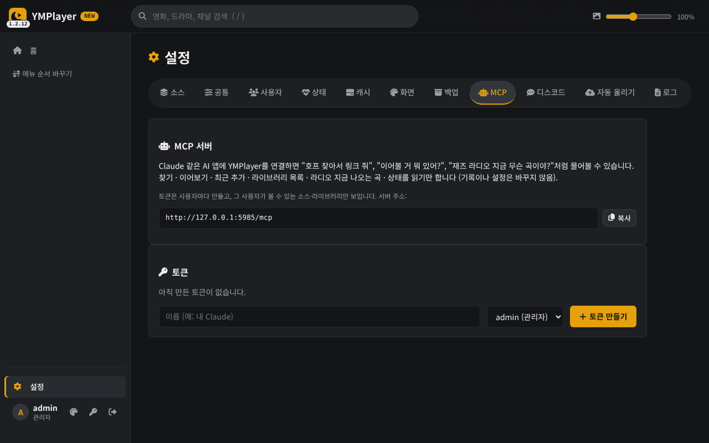

이름과 사용자를 골라 **[토큰 만들기]** → 토큰과 연결 방법이 **한 번만** 보입니다(바로 복사). 토큰은 고른 사용자의 권한으로 동작합니다.
- Claude Code: `claude mcp add --transport http ymplayer https://내주소/mcp --header "Authorization: Bearer ymp_…"`
- Claude 앱(사용자 지정 커넥터): `https://내주소/mcp/ymp_…` (인터넷에서 열리는 **https** 주소여야 함)

---

## 9. 휴대폰에서 쓰기

같은 주소로 휴대폰 브라우저에서 열면 휴대폰 화면으로 나옵니다. 왼쪽 위 ☰로 메뉴를 엽니다.

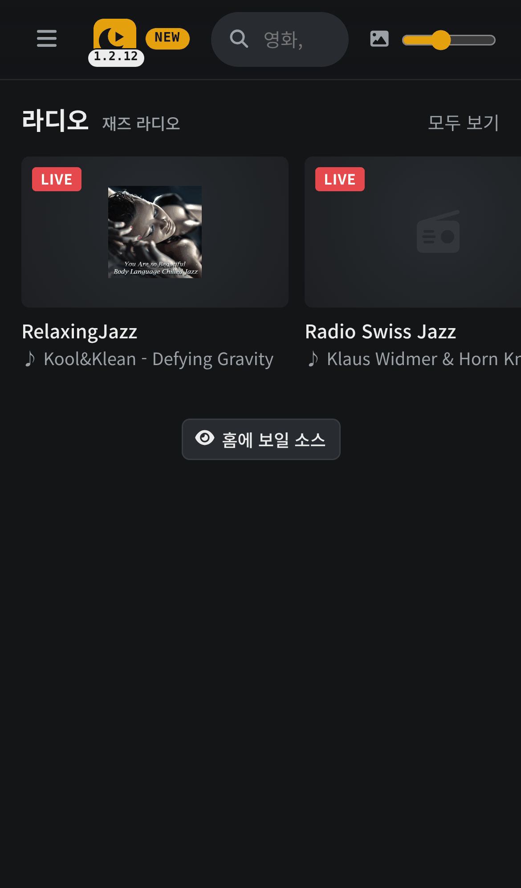

- **앱처럼 설치**: Safari 공유 버튼 → **홈 화면에 추가** / Chrome 메뉴 → **앱 설치** (https 주소에서만).
- 밖에서 볼 때 데이터를 아끼려면 🎨 테마 창 > **데이터 절약**.
- 재생 중 잠금 화면·제어 센터에서 재생/일시정지, 다음/이전을 조작할 수 있습니다.

---

문제가 풀리지 않으면 **설정 > 상태**의 ✗ 이유와 **설정 > 로그**의 [파일 받기] 파일을 같이 남겨 주세요.
